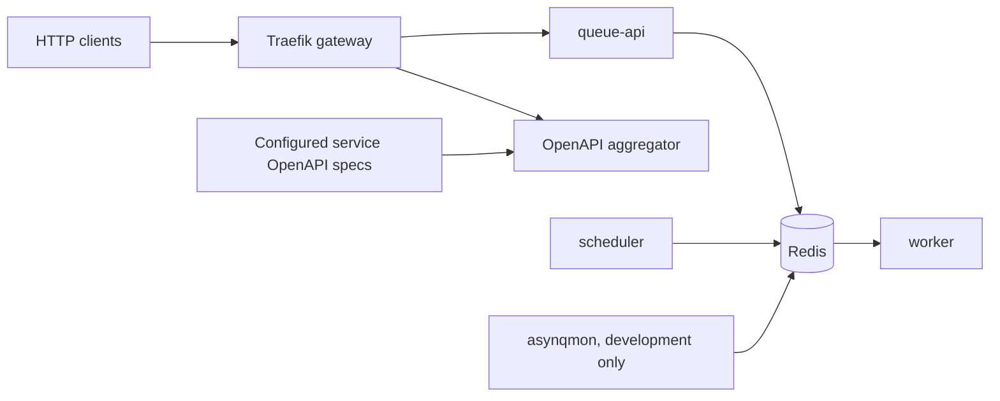

# Posta

**Posta** is a self-hosted Go and Docker stack for accepting background jobs over HTTP, processing them with [Asynq](https://github.com/hibiken/asynq), and aggregating OpenAPI specifications behind a [Traefik](https://traefik.io/traefik/) gateway.

It provides a small deployment-oriented foundation rather than a hosted service or a general-purpose application platform. Bring your own task handlers, API services, and operational policies.

- **HTTP enqueue API** with registered-task validation, allowed queues, and optional static token authentication
- **Redis / Asynq workers** for asynchronous task execution and a scheduler for recurring jobs
- **OpenAPI aggregator** that fetches and merges service specifications at configurable intervals
- **Traefik gateway** with an optional third-party Redis-backed distributed rate-limit plugin
- **Docker Compose development and deployment examples** plus Go build and client-generation tooling

## Why this exists

Services often need a common way to enqueue work without sharing Redis access or embedding queue conventions in every client. Posta packages a narrow HTTP interface, worker processes, an API-spec aggregator, and gateway configuration so you can operate them together while retaining control of task implementations and infrastructure.

**Scope:** Posta does not include business-specific tasks, user management, tenant isolation, a hosted control plane, or a production security configuration. The bundled `generic` module logs submitted payloads; it is for local demonstration and must not be treated as a production job handler.

## Architecture



| Component | Responsibility | Location |
| --- | --- | --- |
| `queue-api` | `POST /v1/enqueue`, `/health`, `/ready`, task and queue validation | `cmd/queue-api/`, `internal/httpapi/` |
| `worker` | Execute handlers registered by enabled task modules | `cmd/worker/`, `internal/modules/` |
| `scheduler` | Register and enqueue schedules supplied by modules | `cmd/scheduler/` |
| `openapi-aggregator` | Refresh, merge, and serve configured OpenAPI sources | `cmd/openapi-aggregator/`, `internal/openapiagg/` |
| Gateway | Reverse proxy and optional request rate limiting | `gateway/traefik/` |
| Deployment | Development, CI override, and production-oriented Compose definitions | `deploy/docker-compose/` |
| API and clients | API contract and TypeScript client examples/generation | `api/`, `clients/`, `scripts/` |

Asynq provides **at-least-once delivery**, not exactly-once execution. Handlers should be idempotent and retry-safe.

## Requirements

- Docker and Docker Compose v2 for the supplied stack
- Go **1.25.3 or compatible Go 1.25 toolchain** for local builds and tests
- Optional: curl for health checks and enqueue examples

## Quick start: local development

The steps below are for a trusted development machine, **not an internet-facing deployment**.

```bash
git clone https://github.com/cadmus-group/posta.git
cd posta
cp .env.example .env
docker network inspect posta-network >/dev/null 2>&1 || docker network create posta-network
./run.sh -c "up -d --build"
```

The development Compose file uses the pre-existing external Docker network `posta-network`. The default example has no Redis password and no enqueue token; keep the stack local. It enables `EDGE_MODULES=generic` so you can exercise the API with a demonstration task.

| Endpoint | Development URL |
| --- | --- |
| Queue API liveness | http://localhost:8080/queue-api/health |
| Queue API readiness (Redis ping) | http://localhost:8080/queue-api/ready |
| Enqueue endpoint | http://localhost:8080/queue-api/v1/enqueue |
| Merged OpenAPI document | http://localhost:8080/openapi.json |
| OpenAPI source status | http://localhost:8080/sources |
| Asynq dashboard (development only) | http://localhost:8082 |

The gateway has a `/queue-api` prefix and strips it before forwarding to `queue-api`. Calling `/v1/enqueue` directly **on the gateway** is not the configured route. The root path redirects to the queue API health route.

Try the included demonstration handler:

```bash
curl -i http://localhost:8080/queue-api/health
curl -i -X POST http://localhost:8080/queue-api/v1/enqueue \
  -H 'Content-Type: application/json' \
  -d '{"type":"generic","queue":"default","payload":{"message":"hello"}}'
docker compose -f deploy/docker-compose/dev.yml logs -f worker
```

You should see an enqueue response containing a task ID and queue, followed by a worker log entry. **Do not enqueue secrets or personal data** to the `generic` handler: it logs payload contents. If you set `ENQUEUE_AUTH_TOKEN` in `.env`, include `-H 'X-Edge-Token: <your-token>'` in enqueue requests.

Stop the stack with `./run.sh -c "down"`. To remove local Redis data as well, use `./run.sh -c "down -v"`.

### Build and test without Compose

```bash
go test ./...
go vet ./...
make build
```

Run individual binaries using `go run ./cmd/queue-api`, `go run ./cmd/worker`, `go run ./cmd/scheduler`, or `go run ./cmd/openapi-aggregator` after configuring access to Redis and the required OpenAPI source file. They do not automatically start dependencies.

### Task modules

The default module catalog currently registers `generic` (see `internal/modules/loader.go`). Set `EDGE_MODULES` consistently for the API, worker, and scheduler; unknown module names fail at startup. To implement real jobs:

1. Define validators and Asynq handlers in a module package using `queue.TaskSpec` (see `internal/modules/generic/register.go`).
2. Register that module in `internal/modules/loader.go` and add optional schedule registration if needed.
3. Enable its name through `EDGE_MODULES` in each relevant service; use `EDGE_ALLOWED_TASK_TYPES` to narrow allowed registered task types.
4. Test validation, idempotency, retries, and any external side effects.

The `internal/` Go packages are not a cross-repository public API. External services can use the documented HTTP contract instead of importing them.

### Calling the API from another service

Clients may call `POST /v1/enqueue` directly on the queue-api service *within a private network*, or `POST /queue-api/v1/enqueue` through the supplied Traefik gateway. The optional token accepts `X-Edge-Token` or `Authorization: Bearer <token>`; this is a **static shared token**, not JWT validation. Unrecognized task types return an `unknown_task` error.

The canonical request and response schemas are in [api/openapi.yaml](api/openapi.yaml). A minimal TypeScript fetch client is in [clients/ts/minimal.ts](clients/ts/minimal.ts); pass a gateway base URL ending in `/queue-api` when using the provided route. See [clients/README.md](clients/README.md) for client generation.

## OpenAPI aggregation

The aggregator reads `OPENAPI_SOURCES_FILE` (normally `config/openapi-sources.yaml`), fetches each configured HTTP(S) or local-file source, and serves merged documentation through `/openapi.json`. Each source requires a distinct `pathPrefix`; optional component and operation prefixes avoid naming collisions.

The development example at [config/openapi-sources.example.yaml](config/openapi-sources.example.yaml) uses the mounted local Posta API specification, so it does not require other projects to be running. For another service, add an entry such as:

```yaml
refreshSeconds: 30
sources:
  - name: queue-api
    openapiUrl: file:///app/api/openapi.yaml
    pathPrefix: /queue-api
    componentPrefix: QueueAPI
    operationPrefix: queueApi
  - name: example-service
    openapiUrl: http://example-service:8080/openapi.json
    pathPrefix: /example
    componentPrefix: Example
    operationPrefix: example
```

Ensure external sources are reachable **from the aggregator container**; mounting a local file or adding a source does not automatically create a matching gateway route. If a source fails, the service may continue serving the last successful merged document, while `/sources` reports failures and aggregator readiness may become unhealthy. `OPENAPI_REFRESH_SECONDS` can override the refresh interval.

## Configuration

Copy [`.env.example`](.env.example) and adjust environment values. Service-specific variants (`QUEUE_API_`, `WORKER_`, `SCHEDULER_`) override shared values in the Go binaries.

| Variable | Default in Go | Meaning |
| --- | --- | --- |
| `REDIS_ADDR` / `REDIS_PASSWORD` / `REDIS_DB` | `redis:6379` / empty / `0` | Redis connectivity |
| `EDGE_MODULES` | empty | Comma-separated module names |
| `EDGE_ALLOWED_TASK_TYPES` | empty | Optional task type allowlist after loading modules |
| `EDGE_ALLOWED_QUEUES` or `QUEUE_ALLOWLIST` | `default,critical` | Enqueue API queue allowlist (see config precedence) |
| `QUEUE_DEFAULT` / `QUEUE_CRITICAL` | `default` / `critical` | Worker queue names |
| `QUEUE_WEIGHT_DEFAULT` / `QUEUE_WEIGHT_CRITICAL` | `5` / `10` | Worker polling weights |
| `ASYNQ_CONCURRENCY` | `20` | Worker concurrency |
| `HTTP_ADDR` | `:8081` | Queue API bind address; aggregator uses `:8083` |
| `HTTP_MAX_BODY_BYTES` | `1048576` | Enqueue HTTP request body limit |
| `HTTP_READ_HEADER_TIMEOUT_MS` | `5000` | Queue API read-header timeout |
| `ENQUEUE_AUTH_TOKEN` | empty | Enables shared-token authentication when nonempty |
| `REDIS_DIAL_TIMEOUT_MS` | `2000` | Redis dial timeout |
| `REDIS_READ_TIMEOUT_MS` / `REDIS_WRITE_TIMEOUT_MS` | `1000` / `1000` | Redis I/O timeouts |
| `REDIS_PING_TIMEOUT_MS` | `1500` | Readiness ping timeout |
| `OPENAPI_SOURCES_FILE` | `config/openapi-sources.yaml` | Aggregator config path |
| `OPENAPI_REFRESH_SECONDS` | from YAML (30s in example) | Optional aggregator refresh override |

The API checks `EDGE_ALLOWED_QUEUES` before `QUEUE_ALLOWLIST` when both are configured, and supports the alias `QUEUE_API_AUTH_TOKEN` for the shared token. Compose can explicitly forward environment variables, so inspect the selected Compose file when overriding service values.

## Deployment boundaries

### Local development

Use `deploy/docker-compose/dev.yml` with a trusted local Docker host. It exposes Redis on port 6379 and the Asynq monitoring UI on port 8082, and neither is suitable for public access. The development Redis container **does not enforce** `REDIS_PASSWORD` simply because that environment variable is set.

### Example server deployment

`deploy/docker-compose/prod.yml` is a starting point, **not a secure production distribution**. It runs Traefik on ports 80/443, Redis inside the Compose network, the Go services, and the OpenAPI aggregator. From the repository root:

```bash
cp .env.example .env
cp config/openapi-sources.example.yaml config/openapi-sources.yaml
# Edit .env, OpenAPI sources, gateway routes, hostname/TLS configuration and Redis credentials.
./run.sh -f deploy/docker-compose/prod.yml -c "up -d --build"
```

The example configuration includes routes for application-specific integrations (`fleet-*` and `liburna-*`), whose services are **not** provided by this repository. Review or replace those gateway routes for your own environment; do not assume the bundled gateway is a standalone production edge configuration. The production Compose file references a separate, untracked `config/openapi-sources.yaml` file.

### Production assumptions and private infrastructure

Before exposing any endpoint, operators are responsible for configuring TLS, network policies, gateway authentication, Redis credentials, trusted proxy settings, token rotation, persistent data, backups, monitoring, rate-limit policy, and access to task queues. Never publish Redis or the Asynq dashboard. Keep the enqueue API private wherever possible. Run only one scheduler replica unless duplicate scheduling is explicitly acceptable or coordinated.

The included rate limiter is the **third-party** `github.com/nzin/traefik-cluster-ratelimit` Traefik plugin, not Traefik's built-in middleware. It is configured for the `/queue-api` route in `gateway/traefik/dynamic.yml`. Review plugin compatibility, Redis credentials, and configuration interpolation for your environment before relying on it; additional gateway routes are not automatically rate-limited.

Kubernetes deployments can use the same Go images with your own Deployments, Services, and ingress configuration. This repository does **not** ship a Kubernetes manifest or Helm chart.

## CI, releases, and development workflow

GitHub Actions runs `go test ./...`, `go vet ./...`, and a Compose smoke test on pull requests and pushes to `main`. Releases use release-please and publish versioned GHCR images for **queue-api**, **worker**, and **scheduler** on GitHub release publication. The OpenAPI aggregator has a Dockerfile but is **not currently published** by that workflow. See [CONTRIBUTING.md](CONTRIBUTING.md) for PR guidance.

## Troubleshooting

- **404 at gateway enqueue endpoint:** use `/queue-api/v1/enqueue`, not `/v1/enqueue` on port 8080.
- **`unknown_task`:** ensure the requested task type is registered and its module is enabled in all relevant processes.
- **401 enqueue response:** configure the matching `ENQUEUE_AUTH_TOKEN` and send `X-Edge-Token` or a Bearer static token.
- **Redis readiness failure:** inspect `REDIS_ADDR`, password configuration, container logs, and the selected Compose network.
- **`/sources` reports failures:** check container DNS, service reachability, mounts, and `pathPrefix` configuration.
- **No 429 responses:** check the gateway route and third-party rate-limit plugin; the HTTP service does not perform gateway-level rate limiting itself.

## Community and license

Contributions are welcome. Read [CONTRIBUTING.md](CONTRIBUTING.md), [CODE_OF_CONDUCT.md](CODE_OF_CONDUCT.md), and [SECURITY.md](SECURITY.md) before filing an issue or opening a PR.

Released under the [MIT License](LICENSE). The repository path and copyright attribution remain with their original owner; using Posta does not require being part of that organization.

