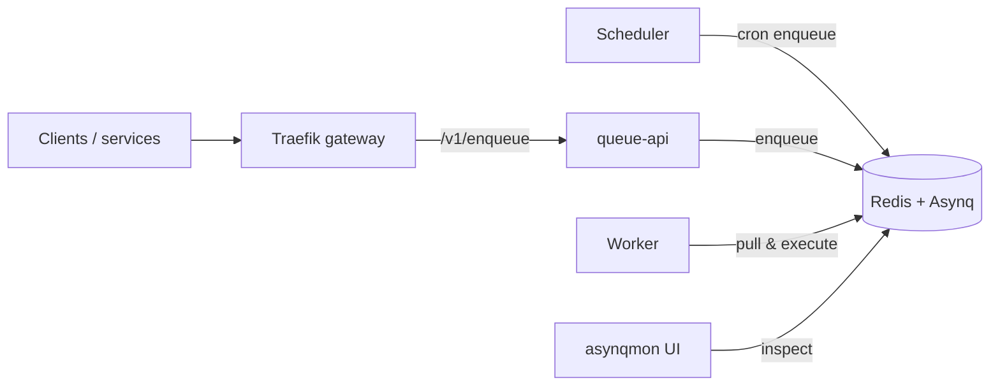

# Posta — Cadmus Internal Developer Guide
_A reusable, container-first “edge + jobs” stack: Traefik API gateway + Redis-backed **cluster** rate limiting + Asynq task queue._

This repo is meant to be **deployed per-project** (separate servers / namespaces / Redis prefixes) and also to plug into Kubernetes-backed microservice systems.

---

## What’s inside

### Edge / Gateway
- **Traefik** as the HTTP entrypoint (`:8080`)
- **Distributed rate limiting (cluster-wide) via Redis** using Traefik’s built-in `rateLimit` with Redis storage.

### Jobs / Background processing
- **queue-api**: small HTTP service that accepts enqueue requests and pushes tasks into Asynq (Redis)
- **worker**: Asynq worker server that processes tasks
- **scheduler**: Asynq scheduler (cron-like) that enqueues periodic tasks
- **asynqmon**: web UI for monitoring & administrating queues

### Local dev
- `deploy/docker-compose/dev.yml` boots everything: Redis + Traefik + services + asynqmon

## Architecture



queue-api and worker share a module-backed registry: the API validates payloads before enqueueing, the worker executes the registered handlers, and the scheduler can enqueue recurring tasks from the same modules.

---

## Requirements

- Docker + Docker Compose v2
- Go toolchain (only needed if you want to run services outside containers)

---

## Quick start (local)

> This skeleton ships **without built-in tasks**. Add at least one module under `internal/modules/` and set `EDGE_MODULES` (comma-separated) for queue-api, worker, and scheduler. Without modules, `/v1/enqueue` will return `unknown_task`.

From repo root:

```bash
cp .env.example .env  # adjust tokens/secrets for your environment
docker compose -f deploy/docker-compose/dev.yml up --build
```

### Local endpoints
- **Gateway (Traefik)**: `http://localhost:8080`
- **Health** (through gateway → queue-api): `http://localhost:8080/health`
- **Readiness** (Redis ping): `http://localhost:8080/ready`
- **Aggregated templates**: `http://localhost:8080/openapi.json`
- **asynqmon UI**: `http://localhost:8082`
- **Redis**: `localhost:6379` (exposed for debugging)

### Enqueue a task (through Traefik)
Replace the `type`/`queue` values with one of your registered modules.
```bash
curl -sS http://localhost:8080/v1/enqueue \
  -H 'content-type: application/json' \
  # add: -H "X-Edge-Token: <token>" if ENQUEUE_AUTH_TOKEN is set
  -d '{"type":"billing:sync","queue":"default","payload":{"accountId":"acc_123"}}'
```

---

## How to use this in other projects

You have two integration patterns. Pick one; don’t mix randomly.

### Pattern A (recommended): Treat this repo as an external “jobs service”
Other services enqueue work by calling `queue-api` through the gateway.

**Pros**
- Language-agnostic (any service can enqueue)
- Central policy enforcement (auth, rate limiting, auditing, tenant rules)
- No Redis credentials spread across your microservices

**Cons**
- You must secure `queue-api` (do **not** expose public enqueue without auth)

**How**
- Deploy this stack (or just queue-api+worker+scheduler) into your environment
- Internal services call `POST /v1/enqueue`

Recommended: keep `queue-api` on a **private network** (or protected by JWT/mTLS at the gateway).

---

### Pattern B (Go-only): Enqueue directly to Asynq (no HTTP hop)
A Go service imports Asynq and enqueues tasks directly to Redis.

**Pros**
- Fewer moving parts
- Lower latency

**Cons**
- Every service needs Redis connectivity + consistent queue/task conventions
- Harder to govern and audit

**Rule:** if we ever allow Pattern B, we will create a `pkg/queueclient` (public) package and **never** import from `internal/` across repos.

---

## How templates auto-work (OpenAPI aggregation)
- Each microservice owns its enqueue endpoints and ships an OpenAPI doc at `/openapi.json` that includes schemas/examples for those endpoints.
- `openapi-aggregator` reads `config/openapi-sources.yaml`, fetches each service spec on a timer, prefixes paths and component names per service, and serves a merged `GET /openapi.json` (and `GET /sources` for debugging).
- Traefik routes `/openapi.json` to the aggregator; it **does not** proxy enqueue calls—those stay routed to the owning microservice path prefixes.
- If one source is down, the aggregator keeps serving the last good merged doc and exposes the failure in `/sources`; `/ready` becomes 503 until the next successful refresh.

### Microservice contract requirements
- Serve OpenAPI at `/openapi.json` (JSON or YAML).
- Use a stable base path (recommended: `/service-name/...` or `/service-name/enqueue/...`) to avoid collisions; the aggregator requires a `pathPrefix` per service.
- Include schemas/examples for request bodies and responses so clients can build templates automatically.
- Keep operationIds unique inside the service; the aggregator will prefix them if collisions occur.

### Linking a new microservice
1) Add a Traefik rule (file provider, Ingress, or mesh) that routes the service’s base path through the gateway.
2) Add the service to `config/openapi-sources.yaml` (or point `OPENAPI_SOURCES_FILE` to another file):
   ```yaml
   refreshSeconds: 30
   sources:
     - name: billing
       openapiUrl: http://billing:8080/openapi.json
       pathPrefix: /billing
       componentPrefix: Billing
       operationPrefix: Billing
   ```
3) Restart `openapi-aggregator` or let it pick up changes on the next refresh.
- `openapiUrl` accepts `http(s)` or `file://` (dev example uses `file://` to read the repo’s sample specs).

### Frontend integration
- Fetch `GET /openapi.json` via the gateway to render enqueue templates or generate clients.
- Call enqueue endpoints through the gateway using the path prefixes defined in the OpenAPI document (e.g., `POST /billing/enqueue/...`).
- Cache if you want, but the aggregator already refreshes periodically; rely on ETag/Last-Modified if your HTTP client supports it.

---

## Task model + reliability expectations

Asynq is an **at-least-once** processing system. Tasks may run more than once.
Write handlers to be:
- **Idempotent**
- Safe to retry
- Defensive with timeouts

Do not put irreversible side effects without idempotency keys (e.g., “charge card” must be deduped).

---

## Authoring task modules

Task types, validators, handlers, and schedules live in **modules** loaded at startup. queue-api uses the registry to validate payloads before enqueueing; worker uses the same registry to dispatch handlers; scheduler loads the same modules to register recurring tasks.

1. Create a package under `modules/<name>/` with `Register` (and optionally `RegisterSchedules`).
2. Add an entry to `moduleCatalog` in `internal/modules/loader.go` pointing at your module.
3. Set `EDGE_MODULES=<name>[,<name2>...]` for queue-api, worker, and scheduler. Optionally tighten with `EDGE_ALLOWED_TASK_TYPES`.

Example module (`modules/billing/register.go`):

```go
package billing

import (
  "context"
  "encoding/json"
  "errors"
  "log/slog"

  "github.com/hibiken/asynq"

  "github.com/cadmus-group/posta/internal/queue"
)

const TypeBillingSync = "billing:sync"

func Register(log *slog.Logger, reg *queue.Registry) error {
  reg.MustRegister(queue.TaskSpec{
    Type: TypeBillingSync,
    Validate: func(payload json.RawMessage) error {
      var p struct {
        AccountID string `json:"accountId"`
      }
      if err := json.Unmarshal(payload, &p); err != nil || p.AccountID == "" {
        return errors.New("accountId required")
      }
      return nil
    },
    Handler: func(ctx context.Context, t *asynq.Task) error {
      log.Info("billing sync", "payload", string(t.Payload()))
      return nil
    },
  })
  return nil
}
```

Register it in `internal/modules/loader.go`:

```go
var moduleCatalog = map[string]moduleSpec{
  "billing": {registerTasks: billing.Register},
}
```

If your module exposes `RegisterSchedules`, the scheduler will call it so you can enqueue periodic tasks.

---

## Configuration

### Environment variables (services)

Copy `.env.example` to `.env` and adjust for your environment. The defaults are safe for local dev; production should set Redis auth and an enqueue auth token. Each binary reads both unprefixed variables and service-prefixed variants (`QUEUE_API_`, `WORKER_`, `SCHEDULER_`); prefixed values win.

Used by `queue-api`, `worker`, `scheduler`:

| Variable | Default | Notes |
|---|---:|---|
| `REDIS_ADDR` | `redis:6379` | Redis host:port |
| `REDIS_PASSWORD` | empty | Set if Redis requires auth |
| `REDIS_DB` | `0` | Redis DB index |
| `REDIS_DIAL_TIMEOUT_MS` | `2000` | Redis dial timeout (ms) |
| `REDIS_READ_TIMEOUT_MS` | `1000` | Redis read timeout (ms) |
| `REDIS_WRITE_TIMEOUT_MS` | `1000` | Redis write timeout (ms) |
| `EDGE_MODULES` | empty | Comma-separated module names to load; required to have any tasks |
| `EDGE_ALLOWED_TASK_TYPES` | empty | Optional allowlist filter applied after modules load (affects queue-api validation, worker handlers, scheduler registrations) |
| `EDGE_ALLOWED_QUEUES` | `default,critical` | Allowed queues for enqueue API (alias for `QUEUE_ALLOWLIST`) |

queue-api:

| Variable | Default | Notes |
|---|---:|---|
| `HTTP_ADDR` | `:8081` | Bind address |
| `HTTP_MAX_BODY_BYTES` | `1048576` | Request size limit |
| `HTTP_READ_HEADER_TIMEOUT_MS` | `5000` | Defensive timeout |
| `ENQUEUE_AUTH_TOKEN` | empty | If set, /v1/enqueue requires `X-Edge-Token` (or `Authorization: Bearer ...`) |
| `QUEUE_ALLOWLIST` | `default,critical` | Allowed queues for enqueue API (falls back to `EDGE_ALLOWED_QUEUES`) |
| `REDIS_PING_TIMEOUT_MS` | `1500` | Timeout for readiness Redis ping |

worker:

| Variable | Default | Notes |
|---|---:|---|
| `ASYNQ_CONCURRENCY` | `20` | Worker concurrency |
| `QUEUE_DEFAULT` | `default` | Queue name |
| `QUEUE_CRITICAL` | `critical` | Queue name |
| `QUEUE_WEIGHT_DEFAULT` | `5` | Weighted polling |
| `QUEUE_WEIGHT_CRITICAL` | `10` | Weighted polling |

---

## Rate limiting (cluster-wide, Redis-backed)

Traefik’s built-in `rateLimit` middleware is configured to store counters in Redis so limits stay consistent across replicas.

### Where to configure it
- `gateway/traefik/traefik.yml` — static config
- `gateway/traefik/dynamic.yml` — routes and middleware config (rate limit, redis address)

### Tuning
Edit `gateway/traefik/dynamic.yml` and adjust:
- `average`
- `burst`
- optional `sourceCriterion` (recommended: limit by API key header, not IP)

**Highly recommended**: rate limit by a stable identity (e.g., `Authorization` header or `X-Api-Key`) rather than IP.
If you rate-limit by IP behind load balancers, you’ll often rate-limit your LB instead of the client unless configured carefully.

---

## Local testing checklist

### 1) Everything up
```bash
docker compose -f deploy/docker-compose/dev.yml up --build
```

### 2) Health works
```bash
curl -i http://localhost:8080/health
```

### 3) Rate limiter works (you should see 429 after you exceed limits)
Example quick burst test (adjust numbers to exceed your config):
```bash
for i in {1..100}; do
  curl -s -o /dev/null -w "%{http_code}\n" http://localhost:8080/health
done | sort | uniq -c
```

### 4) Queue works
Enqueue one of your registered task types and observe in asynqmon:
```bash
curl -sS http://localhost:8080/v1/enqueue \
  -H 'content-type: application/json' \
  -d '{"type":"billing:sync","queue":"default","payload":{"accountId":"acc_123"}}'
```

Open: `http://localhost:8082`

### 5) Automated smoke test
```bash
chmod +x scripts/smoke.sh
./scripts/smoke.sh  # health + rate limit checks
SMOKE_ENQUEUE_PAYLOAD='{"type":"billing:sync","queue":"default","payload":{"accountId":"acc_123"}}' SMOKE_EXPECT_LOG="billing sync" ./scripts/smoke.sh  # also verifies queue path (requires your module)
SMOKE_ENABLE_AUTH=1 ENQUEUE_AUTH_TOKEN=dev-token ./scripts/smoke.sh  # adds auth checks; include SMOKE_ENQUEUE_PAYLOAD to exercise enqueue
```

---

## Deploying (containers) — per project server (VPS / bare metal)

### Build images (optional if not pulling from registry)
```bash
docker build -f Dockerfile.queue-api -t ghcr.io/<org>/edge-stack-queue-api:<tag> .
docker build -f Dockerfile.worker    -t ghcr.io/<org>/edge-stack-worker:<tag> .
docker build -f Dockerfile.scheduler -t ghcr.io/<org>/edge-stack-scheduler:<tag> .
docker build -f Dockerfile.openapi-aggregator -t ghcr.io/<org>/edge-stack-openapi-aggregator:<tag> .
```

### Deploy on a server with docker compose
```bash
cp .env.example .env
# set REDIS_ADDR/REDIS_PASSWORD, ENQUEUE_AUTH_TOKEN, domains, and path prefixes
cp config/openapi-sources.example.yaml config/openapi-sources.yaml
# edit config/openapi-sources.yaml for your services (pathPrefix required)
docker compose -f deploy/docker-compose/prod.yml up -d --build
```
- Traefik listens on :80/:443 and routes `/openapi.json` to the aggregator and `/` to `queue-api`.
- Keep Redis internal (only exposed via the Docker network). Point `REDIS_ADDR` to a managed instance if available.
- Place Traefik behind your existing LB or let it manage TLS via ACME (set `LETS_ENCRYPT_EMAIL` in `.env`).

### Linking external microservices in prod
- Microservices can run outside this compose file as long as they are reachable from the Traefik/OpenAPI network (same Docker network or private LAN/VPC).
- Add each service to `config/openapi-sources.yaml` with `openapiUrl` and `pathPrefix`; restart `openapi-aggregator` or let it refresh.
- Add matching Traefik rules (file provider or Kubernetes Ingress) to route the chosen `pathPrefix` to the target service.

---

## Deploying (Kubernetes)

### Recommended K8s shape
- Use the cluster’s existing Traefik (Ingress Controller) OR deploy Traefik as part of this stack
- Deploy:
  - `queue-api` (Deployment + Service)
  - `worker` (Deployment; scale horizontally)
  - `scheduler` (Deployment; keep at 1 unless you implement leader election)
  - `asynqmon` (optional; internal-only)
- Use managed Redis if possible

### Scaling rules
- Scale **workers** for throughput.
- Keep **scheduler** at 1 replica (unless you implement leader election, otherwise you’ll double-enqueue).
- If you run multiple Traefik replicas, keep rate limiting **Redis-backed** to prevent per-pod unfairness.

### Project isolation (multi-project in one cluster)
Pick one:
- Separate namespaces + separate Redis instances (best)
- Shared Redis with **strict key prefixes** (acceptable if you’re disciplined)
- Separate Redis for rate limit state vs queue data (recommended)

---

## Security (do not ignore this)

Out of the box, this skeleton is intentionally minimal.

Before production:
- Put `queue-api` behind auth (use `ENQUEUE_AUTH_TOKEN` for a simple token gate; prefer JWT/mTLS/API keys in production)
- Rate limit by tenant key, not IP
- Validate task types and payload schema (whitelist allowed types — enforced in `/v1/enqueue`)
- Apply network policies so only internal services can enqueue
- Log and audit enqueue calls (request-id, tenant-id, task type)

---

## Troubleshooting

### Traefik rate limit not applying
- Confirm `gateway/traefik/dynamic.yml` is mounted and includes the `rl` middleware.
- Check that Redis is reachable from Traefik (same Redis used by the app).
- Check Traefik logs in compose:
```bash
docker compose -f deploy/docker-compose/dev.yml logs -f traefik
```

### asynqmon not connecting to Redis
- Confirm Redis is reachable from the container and address matches `--redis-addr`.
- Check logs:
```bash
docker compose -f deploy/docker-compose/dev.yml logs -f asynqmon
```

### Tasks stuck / retrying
- Open asynqmon → inspect task payload and error
- Fix handler idempotency/timeouts
- Increase worker concurrency only after verifying Redis + downstream services can handle the load

---

## Dev standards (Cadmus internal)
- Keep handlers small and composable.
- Prefer deterministic task payload schemas.
- Any side effect must be idempotent.
- For cross-project reuse: keep “public” packages in `pkg/` (create later), not `internal/`.

---

## Roadmap (next hardening steps)
- [x] Add auth + tenant enforcement to queue-api (token gate)
- [x] Add request validation/whitelist for task types
- [ ] Add Prometheus metrics + dashboards
- [ ] Add tracing (OpenTelemetry)
